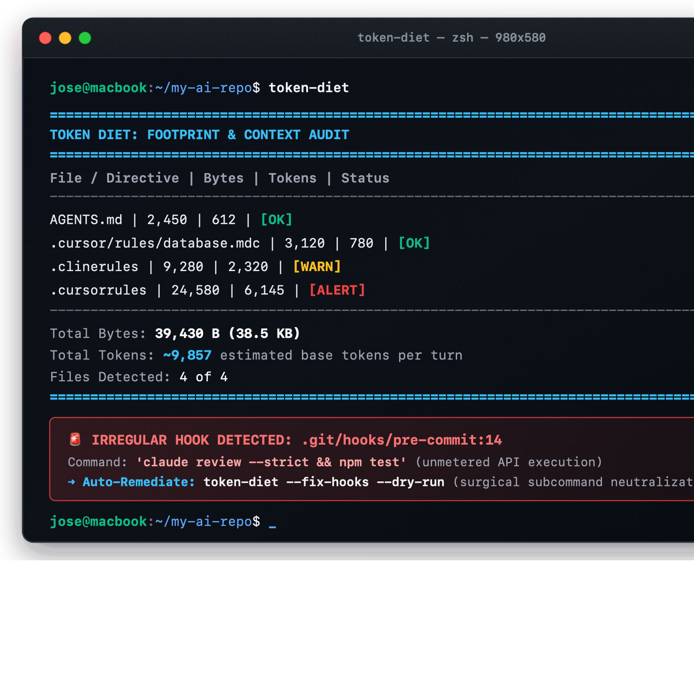

<p align="center">
  
</p>

# token-diet

**The Structural Context & Invisible Waste Auditor for AI Coding Agents**

[](https://github.com/joseoper/token-diet/actions)
[](https://github.com/joseoper/token-diet/releases/latest)
[](https://github.com/joseoper/homebrew-tap)
[](pyproject.toml)
[](src/token_diet)
[](LICENSE)

Audit token footprint, detect hidden context leaks, and prevent token-budget regressions across AI coding workflows.

Zero-dependency CLI for **Claude Code**, **Cursor**, **Codex**, **Gemini CLI**, **OpenCode**, and **Windsurf**.

---

## Why Token Diet?

AI coding assistants accumulate hidden context overhead through oversized instruction directives (`.cursorrules`, `AGENTS.md`, `CLAUDE.md`), declared but unused MCP tool schemas, and unmetered git hooks that trigger cloud LLMs on every local commit.

This structural bloat **reduces available working context for actual code and diagnostics**, introduces **unnecessary idle instructions into every prompt turn**, and creates **costly re-ingestion exposure** upon prompt cache TTL expiration.

`token-diet` audits these structural sources directly on your local filesystem **before** tokens are loaded, serialized, or billed.

---

## Real Terminal Audit in Action

Running `token-diet` delivers an instant diagnostic with zero runtime LLM overhead (< 10 ms execution):



```text
================================================================================
TOKEN DIET: FOOTPRINT & CONTEXT AUDIT
================================================================================
File / Directive                               |     Bytes |    Tokens |   Status
--------------------------------------------------------------------------------
AGENTS.md                                      |     2,450 |       612 |     [OK]
.cursorrules                                   |    18,240 |     4,560 |  [ALERT]
================================================================================
Total Bytes:     20,690 B
Total Tokens:    ~5,172 estimated base tokens per turn
Files Detected:  2 of 2

⚠️  HIGH CONTEXT FOOTPRINT DETECTED:
  Files marked [ALERT] exceed 16 KB (>4k tokens), increasing cache-miss exposure and context footprint.
  Recommendation: Decouple procedures into On-Demand Skills using the LUT Router pattern.
```

---

## Quick 30-Second Install

> **Compatibility:** Requires **Python >= 3.10** (`python3 --version`) and standard library only (0 external dependencies). Compatible with macOS, Linux, and Windows.

### Homebrew (macOS & Linux)
```bash
brew install joseoper/tap/token-diet
```

### pipx (Isolated CLI) / pip
```bash
pipx install token-diet-cli
# Or:
pip install token-diet-cli
```

### Run Directly from Source (No Installation Needed)
```bash
git clone https://github.com/joseoper/token-diet.git
cd token-diet
PYTHONPATH=src python3 -m token_diet
```

---

## What It Does

`token-diet` organizes context defense across four core responsibilities:

| Capability | Scope & Mechanism | Actionable Outcome |
|---|---|---|
| **Audit** | Static filesystem inspection of directives (`AGENTS.md`, `.cursorrules`), global defaults (`--global`), MCP schemas (`--mcp`), and section breakdowns (`--sections`). | Complete inventory of baseline context injection costs per turn. |
| **Detect** | Heuristic flags identifying oversized rules (> 16 KB) and silent AI review invocations in `.git/hooks/pre-commit`. | Instant visual badges (`[OK]`, `[WARN]`, `[ALERT]`, `🚨 HOOK ALERT`). |
| **Enforce** | Deterministic quality gates for CI pipelines: strict limits (`--strict`), token ceilings (`--max-tokens`), and regression budgets (`--baseline`, `--max-delta`). | Blocks pull requests and commits that introduce unbudgeted prompt expansion. |
| **Recommend** | Architectural guidance: the Look-Up Table (LUT) Router pattern and on-demand skill decoupling (`skills/<name>/SKILL.md`). | Projected base context reduction of ~91% while keeping rules accessible on demand. |

---

## Auto-Fix Rogue Git Hooks (`--fix-hooks`)

Neutralize unmonitored AI review commands in `.git/hooks/pre-commit` surgically: replaces offending subcommands on compound lines with `true` (preserving test runners like `npm test` or `pytest`), comments out standalone invocations, creates an atomic `.bak` backup, and preserves executable permissions:

```bash
# Preview changes with a colored unified diff:
token-diet --fix-hooks --dry-run

# Run with interactive confirmation [y/N]:
token-diet --fix-hooks

# Run non-interactively (ideal for automation and CI):
token-diet --fix-hooks -y
```

---

## Why Not Use an LLM Gateway or Compressor?

* **Runtime Gateways (LiteLLM, Portkey):** Operate downstream as network proxies. They are blind to local git hooks, uncommitted directives, or MCP schemas. By the time a gateway sees the payload, tokens have already been read from disk, serialized, and billed.
* **Text Compressors (LLMLingua):** Use small models to drop tokens dynamically at runtime. This introduces inference latency, consumes GPU/CPU cycles, and risks corrupting code syntax, indentation, and architectural constraints.
* **Token Diet:** Operates **at rest** as a static architectural auditor and deterministic CI gatekeeper. Zero dependencies, zero runtime LLM overhead (< 10 ms), and leaves application code completely untouched.

---

## Documentation

Explore the complete documentation for advanced workflows, architecture, and CI integration:

- 📖 **[CLI Usage Guide](docs/usage.md):** Complete command options, flags, section breakdown, and JSON output reference.
- 🏗️ **[Technical Architecture](docs/architecture.md):** Internal module design, hook isolation, static analysis, and boundaries.
- 📊 **[Benchmarks & Methodology](docs/benchmarks.md):** Simulated 20-turn session model, prompt caching reality, and comparison matrix.
- 🛠️ **[Remediation Playbook](docs/remediation-playbook.md):** Step-by-step runbook for the Look-Up Table (LUT) Router pattern.
- 🚀 **[CI/CD Integration](docs/ci-integration.md):** GitHub Actions workflows and pre-commit gatekeeper examples.

---

## Contributing

Contributions, issues, and feature requests are welcome. Review [CONTRIBUTING.md](CONTRIBUTING.md) and [AGENTS.md](AGENTS.md) for local setup and coding guidelines:

```bash
# Run the test suite (131 deterministic tests)
python3 -m unittest discover -s tests -p 'test_*.py'
```

## License

Distributed under the [MIT License](LICENSE). Copyright © 2026 Token Diet Core Team.
