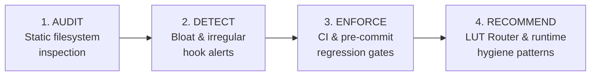

<p align="center">
  
</p>

# token-diet

**The Structural Context & Invisible Waste Auditor for AI Coding Agents**

[](https://github.com/joseoper/token-diet/actions)
[](https://github.com/joseoper/token-diet/releases/latest)
[](https://github.com/joseoper/homebrew-tap)
[](pyproject.toml)
[](src/token_diet)
[](LICENSE)

Audit token footprint, detect silent context leaks, and enforce context budgets in AI agent workflows.

Zero-dependency CLI for **Claude Code**, **Cursor**, **Codex**, **Gemini**, and **OpenCode**.

---

## 1. Why Token Diet?

AI coding assistants inject instruction files (`AGENTS.md`, `CLAUDE.md`, `.cursorrules`, `.windsurfrules`) into the system prompt on **every single turn**. A bloated 25 KB prompt file forces the model to re-process ~6,000–8,400 tokens on every message, draining active context windows and paying full input rates whenever prompt cache entries expire.

Worse, some local developer tools quietly install hidden `pre-commit` hooks that send your entire git diff to an LLM on every commit, or MCP configuration files pack tens of thousands of unused tool schema tokens into your prompt preamble.

`token-diet` scans your repository or workstation in milliseconds to:
- **Audit prompt size:** Flags instruction files that exceed context budgets (`[OK]`, `[WARN]`, `[ALERT]`).
- **Catch rogue git hooks:** Detects and disables silent LLM review hooks in the active hooks directory (`--fix-hooks`), including linked worktrees, submodules, and repositories using `core.hooksPath`.
- **Locate the bloat:** Breaks a Markdown directive down per level-2 heading so you know which section to trim (`--sections`).
- **Audit MCP overhead:** Reports the context cost of every declared MCP server in `opencode.json`, `.mcp.json`, and `mcp.json` (`--mcp`).
- **Guard CI pipelines:** Fails PR builds if prompt expansions exceed token thresholds or regress past a saved baseline (`--strict`, `--max-tokens`, `--baseline`, `--max-delta`).
- **Zero dependencies:** Pure Python standard library (Python >= 3.8). Runs in < 10ms.

### The 6 Vectors of Token Leakage

| Vector | Nature | Status in token-diet | Solution |
|---|:---:|:---:|---|
| **1. Global Prompt Bloat** | Static Directives | `[AUDITED]` | Scanned by `token-diet`. Keep root directives < 3 KB (< 750 tokens) and route to on-demand skills. |
| **2. Invisible Git Hooks** | Execution Leak | `[AUDITED]` | Neutralized with `token-diet --fix-hooks`. Keep commits deterministic; reserve AI reviews for PR CI gates. |
| **3. Reasoning Effort Inflation** | Config Overrun | `[ADVISORY]` | Guidance in [Playbook §1.3](docs/remediation-playbook.md#13-rationalize-reasoning-effort--multi-agent-spawning). Default reasoning to `medium` or `low`. |
| **4. Static MCP Schemas** | Injection Floor | `[AUDITED]` | Scanned with `token-diet --mcp`. Prune unused tool servers and enforce lazy-loading. |
| **5. Cache Prefix Invalidation** | Caching Inefficiency | `[ADVISORY]` | Guidance in [Playbook §3.3](docs/remediation-playbook.md#33-preserve-prompt-cache-prefix-immutability). Maintain immutable, deterministic instruction prefixes. |
| **6. In-Session Inefficiencies** | Runtime History | `[ADVISORY]` | Guidance in [Playbook Phase 4](docs/remediation-playbook.md#phase-4-in-session-runtime-hygiene-active-execution-guards). Line-range reads, targeted diffs, and 80k-token compaction cutoffs. |

---

## 2. Real Terminal Audit in Action

Running `token-diet` in your repository delivers an instant, zero-latency diagnostic of your active prompt directives and git hook security:


### Health Status Indicators

| Indicator | Byte Threshold | Estimated Tokens | What it Means & Recommended Action |
|---|:---:|:---:|---|
| 🟢 `[OK]` | `< 4 KB` | `< 1,000 tokens` | **Optimal Context:** Ultra-lean static directive: leaves maximum headroom for codebase context while minimizing cache-miss re-ingestion costs. |
| 🟡 `[WARN]` | `4 KB – 16 KB` | `1,000 – 4,000 tokens` | **Moderate Size:** Acceptable, but review for duplicate instructions or unneeded verbosity. |
| 🔴 `[ALERT]` | `> 16 KB` | `> 4,000 tokens` | **Severe Prompt Bloat:** Monolithic rules degrade reasoning and waste context budget every turn. Decouple into On-Demand Skills. |
| 🚨 `[HOOK ALERT]` | — | — | **Hidden Token Bleed:** The active `pre-commit` hook sends code to cloud LLMs on every `git commit`. Replace with static linters. |

---

## 3. Quick 30-Second Install

### Via Homebrew (macOS & Linux)
```bash
brew install joseoper/tap/token-diet
# Or:
brew tap joseoper/tap
brew install token-diet
```

### Via `pipx` (Recommended for Isolated CLI)
```bash
pipx install token-diet-cli
```

### Via `pip` / `uv`
```bash
# Using pip:
pip install token-diet-cli

# Using uv:
uv tool install token-diet-cli
```

### Running Directly from Source (No Installation Needed)
```bash
git clone https://github.com/joseoper/token-diet.git
cd token-diet
PYTHONPATH=src python3 -m token_diet
```

---

## 4. Core Capabilities: Audit, Detect, Enforce, Recommend

`token-diet` organizes token defense across four clear architectural responsibilities:



| Capability | Scope & Mechanism | Actionable Outcome |
|---|---|---|
| **Audit** | Static inspection of filesystem artifacts: prompt directives (`AGENTS.md`, `CLAUDE.md`, `.cursorrules`), global workstation defaults (`--global`), declared MCP tool schemas (`--mcp`), and heading breakdowns (`--sections`). | Complete inventory of base token injection costs per turn before execution. |
| **Detect** | Heuristic evaluation identifying oversized monolithic rules (> 16 KB / > 4,000 tokens) and irregular git hooks in `.git/hooks/pre-commit` or `core.hooksPath` running silent AI reviews. | Instant visual flags (`[WARN]`, `[ALERT]`, `🚨 IRREGULAR HOOK DETECTED`) pointing to the exact line and file. |
| **Enforce** | Deterministic quality gates for CI pipelines and pre-commit checks: strict limits (`--strict`), hard token ceilings (`--max-tokens <N>`), and baseline regression budgets (`--baseline`, `--max-delta <%>`). | Blocks PRs and commits that introduce unbudgeted prompt expansion or creeping regressions. |
| **Recommend** | Architectural solutions and runtime practices: the Look-Up Table (LUT) Router pattern, on-demand skill decoupling (`skills/<name>/SKILL.md`), and in-session execution hygiene. | Drops static base tokens by 91% while preserves rule accessibility on-demand without cognitive clutter. |

---

## 5. Where Token Diet Fits: Structural Context vs. Runtime Gateways

> *"Most token optimization tools optimize the request. Token Diet audits the architecture that creates the request."*

Most LLM optimization tooling operates downstream at runtime—proxying HTTP traffic or compressing prompt text on the fly. `token-diet` addresses the upstream architectural cause: **unmanaged, bloated instruction files, declared MCP schemas, and unmetered git hooks living directly in your repository**.


### Architectural Comparison

| Dimension | Runtime Gateways (LiteLLM, Portkey) | Text Compressors (LLMLingua) | **Token Diet** |
|---|---|---|---|
| **Operating Layer** | Network / API Proxy | Model Inference / Runtime Middleware | **Local Filesystem & CI/CD Pipeline** |
| **Inspection Scope** | Outgoing API request payloads | Raw text prompt strings | **Directives (`AGENTS.md`), MCP configs, Git hooks** |
| **Execution Point** | After prompt is assembled & sent | During prompt assembly | **Pre-flight (Pre-commit, CI, local CLI)** |
| **Runtime Overhead** | Proxy network latency | CPU/GPU inference latency (small LM) | **Zero (pure Python stdlib, < 10 ms)** |
| **Code & Syntax Safety** | Transparent passthrough | Risk of AST, indentation, or syntax corruption | **Deterministic, zero-hallucination static filesystem analysis (code safe, leaves application logic untouched)** |
| **Hook & MCP Visibility** | ❌ Blind to local git hooks & MCP configs | ❌ Blind to local git hooks & MCP configs | **✅ Full audit of hooks & declared MCP schemas** |
| **CI Budget Enforcement** | ❌ Reactive billing alerts | ❌ No CI pipeline enforcement | **✅ Strict thresholds, baselines, and delta gates** |

* **Runtime Gateways (LiteLLM, Portkey):** Handle API routing, multi-provider fallbacks, and centralized usage logging. However, they are completely blind to uncommitted local directives, invisible `.git/hooks/pre-commit` scripts, or workstation-wide prompt bloat. By the time a gateway sees the payload, the tokens have already been loaded, serialized, and billed.
* **Runtime Compressors (LLMLingua):** Use small language models or perplexity filtering to drop prompt tokens dynamically before dispatch. While useful for free-form prose, runtime compression introduces noticeable latency, burns local compute cycles, and risks damaging code syntax, indentation, and strict architectural constraints.
* **Behavioral Prompt Guides (e.g., Agensi's Cut Agent Token Costs):** Broad conceptual frameworks that coach agents to "be concise" and choose smaller models. While valuable for in-session behavior, prompt guides are not executable software—they rely entirely on the LLM's willingness to remember instructions under severe context drift, cannot measure exact file bytes or MCP schemas, and cannot fail a CI pull request build.
* **Token Diet:** Operates **at rest** as a static structural context auditor and deterministic linter. It prevents context pollution at the architectural source—measuring exact filesystem artifacts, neutralizing unmonitored hooks programmatically, and blocking PR regressions in CI (< 10 ms, zero dependencies).

---

## 6. Context Savings Model & Methodology

### Technical Rigor: How Prompt Caching Really Works (and Why Bloat Still Kills)

> [!IMPORTANT]
> **Prompt Caching & Context Headroom Reality**  
> *Smaller static context reduces context-window pressure and cache-miss exposure. However, prompt caching depends on prefix stability, provider-specific caching rules and request structure, not prompt size alone.*

There is a widespread misconception regarding modern prompt caching (Anthropic prompt caching, OpenAI prefix caching):

> *"If the provider caches prompt prefixes at a discount, does prompt bloat even matter?"*

**The short answer: Yes, more than ever.**

#### How Prefix Caching Works
Prefix cache eligibility is determined strictly by prefix immutability and meeting minimum length thresholds (e.g., 1,024 tokens for Anthropic Claude Sonnet/Opus and OpenAI), not by keeping files below an arbitrary small size ceiling. Modern frontier providers match tokens sequentially starting from **token index 0** (the prompt prefix):
* In **Anthropic**, caching applies to prefix blocks (minimum 1,024 tokens on Sonnet/Opus, 2,048 on Haiku) marked with cache breakpoints or implicit checkpoints.
* In **OpenAI**, caching automatically matches prefix sequences in 1,024-token increments from the start of the message array.

A long static prompt **does NOT break prompt caching by itself**. If a 25 KB `AGENTS.md` file remains byte-for-byte identical at the beginning of the prompt sequence, the provider will hit the cache.

#### What Actually Breaks Prompt Caching
What invalidates prefix caching is **modifying the prefix or injecting dynamic tokens ahead of it**:
1. Prepending dynamic variables (timestamps, volatile session UUIDs, non-deterministic workspace paths).
2. Modifying even a single character in the system prompt or introductory directives.
3. Swapping tool schemas or re-ordering MCP declarations before the instruction block.

#### The Real Cost of Bloat: Cache Misses & Memory Starvation
Even when prefixes are kept strictly immutable, monolithic prompts inflict severe operational damage:

1. **The Cache Miss Penalty:** Cache entries are ephemeral. In Anthropic, prompt cache TTL is typically **5 minutes of developer think-time** or session pause; in OpenAI, cache blocks are evicted dynamically under memory pressure. Whenever TTL expires or a developer switches branches, you pay **100% of the standard input rate** over 25+ KB (6,000–8,400+ tokens) of redundant instructions on every single turn.
2. **Context Window Starvation:** Cache hit or miss, **cached tokens still occupy active context window capacity**. An 8,400-token static prompt permanently subtracts 8,400 tokens from the model's attention span on *every single turn*.
3. **Reasoning Decay ("Needle-in-a-Haystack" Degradation):** Drowning the model in 25 KB of monolithic guidelines dilutes attention. Frontier models suffer retrieval and instruction-following degradation when key architectural constraints are buried under pages of irrelevant protocols.
4. **Premature Session Compaction:** Bloated base directives rapidly push long conversations into the 80k–100k token danger zone, forcing early thread restarts and loss of working memory.

### Simulated 20-Turn Session Model: Monolithic Directives vs. Token Diet LUT Router

Below is a simulated 20-turn session model measuring base context consumption and memory retention across a standard 20-turn agent coding session (without synthetic pricing estimates—strictly token quantities and usable memory share):


### Token Footprint & Context Retention Comparison

| Metric | Monolithic Directives (No Diet) | With Token Diet (LUT Router) | Impact / Gain |
|---|:---:|:---:|:---:|
| **Base Overhead per Turn** | ~8,400 tokens | ~750 tokens | **-91% base tokens** |
| **Cumulative Ingestion (20 Turns)** | ~168,000 tokens | ~15,000 tokens | **-153,000 tokens spared** |
| **Boilerplate Context Share** | **~75%** of base context | **< 8%** of base context | **-67% static context footprint** |
| **Active Context Headroom for Code & Reasoning** | **~25%** (Heavily constrained) | **> 92%** (Abundant capacity) | **+70% freed working headroom** |
| **Cache Miss Re-ingestion Penalty** | 8,400 tokens / miss | 750 tokens / miss | **-91% penalty exposure** |
| **Attention Focus & Retrieval Accuracy** | High risk of instruction dilution | Laser-focused on active task | **Minimizes attention dilution & Lost-in-the-Middle retrieval degradation** |

> [!NOTE] **Methodological Framework & Model Parameters**
> - **Token Estimation Heuristic:** Based on the standard `cl100k_base` / `o200k_base` estimation heuristic (~4 characters/bytes per token for structured Markdown/prose).
> - **Session Dynamics:** Models a standard 20-turn active coding workflow where the monolithic directive (~8,400 tokens) is re-ingested into context on every turn versus the LUT Router (base ~750 tokens + ~1,200 tokens during turns where specialized domain skills are loaded on demand, modeled in ~25% of turns).
> - **Reference Context Window:** Calibrated against standard 128k/200k active context windows (e.g., Claude 3.5 Sonnet, GPT-4o, Gemini 1.5/2.0), demonstrating how the LUT Router frees working memory for code context, test outputs, and compiler diagnostics rather than static boilerplate.

*In a monolithic configuration, ~75% of your conversational context is permanently consumed by idle guidelines that never get used during the session. With Token Diet's LUT Router, 92%+ of your context remains dedicated to actual source code, test failures, and reasoning.*

---

## 7. Practical CLI Recipes & Usage

### 1. Auto-Fix Silent Pre-Commit Hooks (`--fix-hooks`)
Neutralize unmonitored AI review tooling in `.git/hooks/pre-commit` surgically: replaces only the offending subcommand, creates a `.bak` backup, and preserves permissions:

```bash
# Preview changes with a colored unified diff without modifying files:
token-diet --fix-hooks --dry-run

# Run with interactive confirmation [y/N]:
token-diet --fix-hooks

# Run non-interactively (ideal for automation and scripts):
token-diet --fix-hooks -y
```

### 2. Audit System-Wide Global Prompts (`--global`)
Scan default assistant instruction files across your entire workstation (`~/.claude/CLAUDE.md`, `~/.codex/AGENTS.md`, `~/.gemini/GEMINI.md`, etc.):

```bash
token-diet --global
```

### 3. Audit Specific Paths or Folders
```bash
# Audit a single file
token-diet AGENTS.md

# Audit entire directories recursively
token-diet docs/
```

### 4. Locate Prompt Bloat per Heading (`--sections`)
A monolithic directive rarely bloats evenly. This breakdown attributes bytes and estimated tokens to every level-2 (`##`) heading, so you know exactly which section to compress or move into an on-demand skill:

```bash
token-diet --sections AGENTS.md
```

```text
SECTION BREAKDOWN: MARKDOWN HEADING FOOTPRINT
================================================================================
AGENTS.md  (23,914 B / ~5,978 tokens)
  Line | Heading                                  |     Bytes |    Tokens |   Status
--------------------------------------------------------------------------------
     1 | (preamble)                               |       412 |       103 |              [OK]
    12 | Core Directives                          |    19,220 |     4,805 |           [ALERT]
    98 | Additional Protocols                     |     4,282 |     1,070 |            [WARN]
--------------------------------------------------------------------------------
```

Content before the first `##` heading is grouped as `(preamble)`, and deeper headings (`###`) stay attributed to their parent section. Combine with `--json` for machine-readable output.

### 5. Audit MCP Configuration Footprint (`--mcp`)
Every declared MCP server adds configuration overhead, and some configs inline large tool schemas. `token-diet` discovers local `opencode.json`, `.mcp.json`, `mcp.json`, `.cursor/mcp.json`, and `.vscode/mcp.json` files and reports the estimated configuration footprint per server:

```bash
token-diet --mcp
```

```text
ESTIMATED MCP CONFIGURATION FOOTPRINT
================================================================================
opencode.json  [opencode]  (2 server(s))
Server                         | Transport | Tools |     Bytes |    Tokens |   Status
--------------------------------------------------------------------------------
engram                         | local     |    12 |    18,430 |     4,607 |           [ALERT]
web-search                     | remote    |     0 |       142 |        35 |              [OK]
--------------------------------------------------------------------------------
```

### 6. Fail on Regression vs a Saved Baseline (`--baseline`, `--max-delta`)
Record a baseline once, then gate every pull request against it. This catches slow, incremental growth that a fixed threshold never notices:

```bash
# Save the baseline on your default branch
token-diet --json > token-baseline.json

# Fail if the total grows more than 5% in a pull request
token-diet --baseline token-baseline.json --max-delta 5
```

---

## 8. Automated CI/CD & Pre-Commit Enforcement

### Automated CI / Pre-Commit Gates (`--strict`, `--max-tokens`)
Integrate into your CI pipeline or Git pre-commit workflow to prevent prompt regressions:

```bash
# Fail CI if prompt footprint exceeds 2,500 tokens:
token-diet --max-tokens 2500 AGENTS.md

# Fail CI if any file triggers a [WARN] or [ALERT]:
token-diet --strict docs/
```

### Structured Telemetry Output (`--json`)
Emit structured JSON for automated pipelines, threshold assertions, or telemetry dashboards:

```bash
token-diet --json
```

### GitHub Actions CI Gate Example

Add this workflow to `.github/workflows/token-gate.yml` to block PRs with prompt bloat:

```yaml
name: Token Budget Gate
on: [pull_request]

jobs:
  token-diet:
    runs-on: ubuntu-latest
    steps:
      - uses: actions/checkout@v4
      - uses: actions/setup-python@v5
        with:
          python-version: "3.11"
      - run: pip install token-diet-cli
      - run: token-diet --max-tokens 2500 AGENTS.md
```

### What To Do When a Leak is Detected (Action Paths)

When `token-diet` flags an irregularity, follow the corresponding action path (detailed runbooks available in the [Remediation Playbook](docs/remediation-playbook.md)):

#### Path A: When an Irregular Git Hook is Flagged (`🚨 IRREGULAR HOOK DETECTED`)
* **Problem:** A local hook inside `.git/hooks/pre-commit` secretly sends git diffs to cloud AI tools on every single commit.
* **Action Path:**
  1. Preview neutralization safely: `token-diet --fix-hooks --dry-run`
  2. Apply surgical remediation: `token-diet --fix-hooks`
  3. Relocate semantic AI reviews to **Pull Request gates in CI** (see [CI/CD Integration](docs/ci-integration.md)), where reviews are metered and visible.

#### Path B: When an Agent Directive is Bloated (`🔴 [ALERT]`)
* **Problem:** A root instruction file (`AGENTS.md`, `CLAUDE.md`, `.cursorrules`) exceeds 16 KB (> 4,000 tokens), inflicts severe cache-miss penalties upon 5-min TTL expiration and starves active context window.
* **Action Path (The Look-Up Table / LUT Router Pattern):**
  1. **Extract Specialized Protocols:** Move detailed procedure manuals, test specifications, and review arbitrations into standalone on-demand skills (e.g., `skills/<skill-name>/SKILL.md`).
  2. **Compress Root Directive:** Keep only core behavioral invariants and a routing index in the root file (< 3 KB / < 750 tokens):
     ```markdown
     ## On-Demand Skills
     - When running database migrations, read `skills/db-migrate/SKILL.md`.
     - When preparing a release, read `skills/oss-publisher/SKILL.md`.
     ```
  3. Re-run `token-diet` to confirm the status turns 🟢 `[OK]`.

#### Path C: When CI Fails on Token Budget Exceeded (`exit code 1`)
* **Problem:** A Pull Request introduced unbudgeted prompt expansion that violated `--max-tokens <N>` or `--strict`.
* **Action Path:**
  1. Run `token-diet --json` to get the machine-readable breakdown of offending files.
  2. Prune duplicate rules or extract text into skills.
  3. Re-run local check before pushing: `token-diet --strict`.

#### Agentic Remediation: Prompt for AI Assistants

To have your AI coding assistant (Claude Code, Gemini CLI, Cursor, Windsurf, OpenCode) remediate prompt bloat autonomously without manual edits, copy and paste this prompt:

```text
Run `token-diet` in this repository. If you detect any files marked [ALERT] or [WARN], follow `docs/remediation-playbook.md` to decouple operational procedures into on-demand skills under `skills/<skill-name>/SKILL.md`. Compress the root instruction file to a concise Look-Up Table (LUT Router) under 3 KB (< 750 tokens). If an irregular hook is flagged, run `token-diet --fix-hooks`. Verify that all tests pass and `token-diet` reports [OK].
```

---

## 9. Limitations & Technical FAQ

### Limitations & Technical Boundaries

To maintain zero runtime dependencies and millisecond-level execution, `token-diet` operates with clear, deliberate technical boundaries:

| Dimension | How it Works | Operational Boundary |
|---|---|---|
| **Token Estimation** | Fast heuristic (~4 bytes per token) | Heuristic estimation without provider-specific tokenizer overhead. Code density (~2.5-3.2 bytes/token) and non-Latin scripts will have slight variance. |
| **MCP Schemas** | Static analysis of local config declarations | Reports declared schema overhead. Schemas fetched dynamically by servers at runtime via protocol handshakes are not measurable statically. |
| **Git Hooks Remediation** | Regex and boundary-aware command matching | `--fix-hooks` neutralizes detected AI commands and creates `.bak` backups. Verify your hook manually if using complex custom scripts. |
| **Directive Scope** | Standard file patterns (`AGENTS.md`, `.cursorrules`, etc.) | Audits well-known directives. Custom tooling with obscure instruction naming paths should be passed explicitly as target paths. |

### Technical FAQ

#### Q: If frontier models offer prompt caching discounts, why does static prompt bloat matter?
**A:** Because prompt cache discounts only apply while the cache entry is warm. In Anthropic, prompt cache entries expire after **5 minutes of developer pause**; in OpenAI, cache blocks are evicted dynamically under memory pressure. When TTL expires or you switch tasks, you pay 100% full price on every token. Furthermore, cached tokens still subtract from your model's active attention window on every single turn, aggravating attention dilution (*Lost in the Middle*).

#### Q: Does token size matter if my model has a 1M or 2M token context window?
**A:** Yes. Context window capacity is not synonymous with effective working memory. As prompt context grows, LLM reasoning latency rises and attention degrades across long documents. In addition, API pricing is charged on every single turn: processing 25 KB of monolithic guidelines across 30 turns generates hundreds of thousands of unnecessary input tokens.

#### Q: Why not use runtime API proxies or prompt text compressors instead?
**A:** Runtime proxies (LiteLLM, Portkey) operate after tokens have already been read from disk and serialized, and they are completely blind to local git hooks or MCP schema definitions. Runtime compressors (LLMLingua) add model latency and risk corrupting code syntax, indentation, and architectural constraints. `token-diet` is a zero-latency, zero-dependency static linter operating directly on the filesystem before tokens are sent.

#### Q: How does `--fix-hooks` ensure safety when modifying git hooks?
**A:** `--fix-hooks` never destroys code. It creates an atomic `.bak` backup file before modifying anything, isolates unmonitored AI review commands using boundary-aware regex matching, and preserves executable permissions on the active hook script.

---

## 10. Architecture, Testing & Advanced Documentation

### Running Tests

Token Diet includes an automated test suite with deterministic coverage:

```bash
python3 -m unittest discover -s tests -p 'test_*.py'
```

### Repository Structure

```
token-diet/
├── .github/
│   └── workflows/
│       └── ci.yml             # Automated multi-version CI test runner
├── assets/
│   ├── terminal_preview.png   # Real terminal audit screenshot
│   ├── terminal_preview.svg   # Vector SVG terminal preview
│   ├── comparison_matrix.jpg  # Architecture comparison matrix
│   ├── context_benchmark_chart.jpg # Context footprint benchmark chart
│   ├── logo.png               # Public Open-Source banner logo (1200x400)
│   ├── logo_icon.png          # Public Open-Source square icon (512x512)
│   ├── logo_icon.svg          # Vector SVG icon source
│   ├── logo_agensi.png        # Agensi Marketplace edition banner logo (1200x400)
│   ├── logo_agensi_icon.png   # Agensi Marketplace edition square icon (512x512)
│   └── logo_agensi_icon.svg   # Agensi vector SVG icon source
├── docs/
│   ├── remediation-playbook.md # Step-by-step token containment and LUT routing
│   └── ci-integration.md       # CI workflows & pre-commit gatekeeper examples
├── src/
│   └── token_diet/            # Core Python package (Zero external dependencies)
│       ├── __init__.py
│       ├── __main__.py
│       ├── baseline.py        # Baseline comparison & regression budget gate
│       ├── cli.py             # CLI implementation and footprint engine
│       ├── git_hooks.py       # Worktree, gitdir and core.hooksPath resolution
│       ├── mcp_audit.py       # MCP config discovery & payload accounting
│       ├── metrics.py         # Shared byte thresholds and token estimation
│       └── sections.py        # Per-heading Markdown footprint breakdown
├── tests/
│   ├── test_baseline.py       # Baseline budget unit tests
│   ├── test_git_hooks.py      # Hook resolution unit tests
│   ├── test_mcp_audit.py      # MCP payload unit tests
│   ├── test_sections.py       # Section breakdown unit tests
│   └── test_token_audit.py    # Core engine and CLI integration tests
├── .gitignore
├── AGENTS.md                  # Agent-friendly repository directives
├── CONTRIBUTING.md            # Contribution guidelines & engineering principles
├── LICENSE                    # MIT Open Source License
├── pyproject.toml             # PEP 621 packaging and CLI entrypoint
└── README.md                  # Project overview and documentation
```

### Platform Compatibility

Token Diet is OS-agnostic and cross-platform:
- **CLI Diagnostic Tool:** Pure Python standard library with zero third-party dependencies. Runs seamlessly on **macOS**, **Linux**, and **Windows** (Python >= 3.8).
- **Universal Methodology:** Core principles apply across all assistants (Claude Code, Gemini CLI, OpenAI Codex, OpenCode, Cursor, Windsurf).

### Documentation & Guides

For in-depth operational procedures and automated pipeline setups:
- **[Remediation Playbook](docs/remediation-playbook.md):** Step-by-step runbook to prune prompt files, configure reasoning effort, and contain background services.
- **[CI/CD Integration](docs/ci-integration.md):** GitHub Actions workflows and pre-commit configurations for automated token budget enforcement.
- **[Agent Directives (AGENTS.md)](AGENTS.md):** Operational guidelines for AI coding assistants working on this codebase.
- **[Contributing Guidelines](CONTRIBUTING.md):** How to run tests, submit pull requests, and coding standards.

### License

This project is licensed under the terms of the [MIT License](LICENSE).
