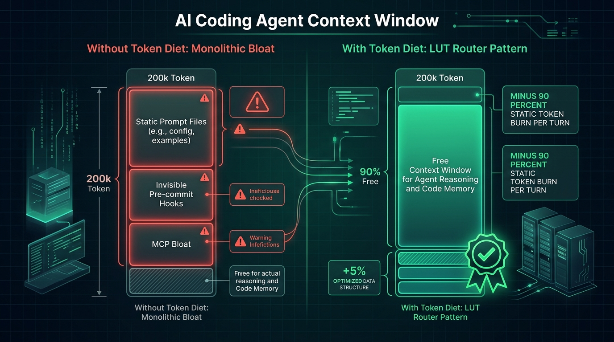
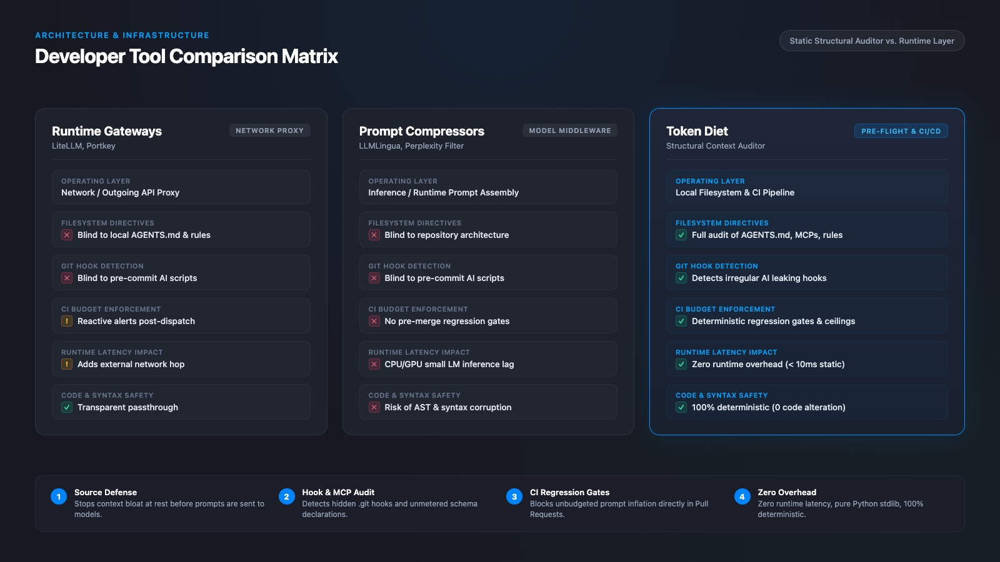

# Token Diet — Benchmark Methodology & Context Efficiency

This document details the simulation model, empirical framework, and comparative architecture behind `token-diet`'s context optimization methodology.

---

## 1. The Context Problem in Agentic Workflows

Modern AI coding assistants (Claude Code, Cursor, Codex, OpenCode, Windsurf) operate in multi-turn conversational loops. As repositories scale, teams inadvertently bloat instruction directives (`.cursorrules`, `CLAUDE.md`, `AGENTS.md`), inject dozens of unused MCP schemas, and trigger unmetered git hooks.

This structural bloat imposes three operational penalties:
1. **Context Window Starvation:** Every token of idle instructions permanently robs working memory from actual source code, test failures, and compiler diagnostics.
2. **Attention Dilution (*Lost-in-the-Middle*):** Drowning the model in 25+ KB of monolithic rules degrades instruction-following accuracy and increases hallucination risks on complex algorithmic tasks.
3. **Cache-Miss Financial Exposure:** While frontier providers offer prompt caching discounts, cache blocks are ephemeral (e.g., 5-minute TTL in Anthropic, dynamic eviction in OpenAI). When a cache miss occurs, the entire bloated preamble must be re-ingested at full input rates.

---

## 2. Simulated 20-Turn Session Model

To evaluate the operational impact of prompt architecture, we model a standard 20-turn active software engineering session comparing two configurations:
* **Monolithic Directive (No Diet):** A single 25 KB instruction file (~8,400 tokens) loaded into context on every turn.
* **With Token Diet (LUT Router Pattern):** A compressed root directive (~750 tokens) containing core invariants and a Look-Up Table routing to specialized domain skills on demand (modeled as loading an additional ~1,200 tokens during ~25% of turns).

### Projected Base Context Reduction: 91%

| Metric | Monolithic Directives (No Diet) | With Token Diet (LUT Router) | Impact / Gain |
|---|:---:|:---:|:---:|
| **Base Overhead per Turn** | ~8,400 tokens | ~750 tokens | **-91% base static overhead** |
| **Cumulative Attention Load (20 Turns)** | ~168,000 tokens | ~15,000 tokens | **-153,000 tokens exposed** |
| **Static Directive Footprint** | ~8,400 tokens / turn | ~750 tokens / turn | **-91% static footprint** |
| **Share of Initial Working Context (~11k tokens)** | **~75%** static guidelines | **< 8%** static guidelines | **+67% initial working capacity freed** |
| **Cache Miss Re-ingestion Exposure** | 8,400 tokens / miss | 750 tokens / miss | **-91% re-ingestion risk** |
| **Attention Focus & Retrieval Accuracy** | High risk of instruction dilution | Laser-focused on active task | **Minimizes instruction dilution & Lost-in-the-Middle degradation** |

### Methodological Parameters & Rigor

* **Token Estimation Heuristic:** Based on the standard `cl100k_base` / `o200k_base` heuristic (~4 characters/bytes per token for structured Markdown/prose).
* **Projected Base Context Reduction (91%):** Mathematical reduction calculated strictly on the static prompt baseline:
  $$\text{Reduction} = 1 - \frac{750}{8,400} = 91.07\%$$
  It measures the reduction of persistent instructional overhead injected into each turn, rather than a guaranteed flat discount on the final API invoice.
* **Cumulative Attention Load vs. Billed Tokens:** The ~168,000 tokens represent gross cumulative exposure to the model's attention window across 20 turns. Under modern prompt caching, warm cache hits are billed at reduced rates; however, cache misses (upon TTL expiry or cache eviction) and attention dilution remain directly proportional to static prompt size.
* **Initial Turn Context Share:** In a typical turn-1 payload (~11,200 tokens total: base directives + initial code/task description), an 8,400-token monolithic file consumes ~75% of that initial context payload. With the LUT Router (~750 tokens), static boilerplate occupies less than 8%, leaving over 92% of the initial prompt capacity available for source code, test failures, and compiler diagnostics.

---

## 3. How Modern Prompt Caching Works (and Why Bloat Still Matters)

There is a widespread misconception regarding modern prompt caching:
> *"If the provider caches prompt prefixes at a discount, does prompt bloat even matter?"*

**The short answer: Yes, more than ever.**

### Prefix Immutability vs. File Size
Modern frontier providers match tokens sequentially starting from **token index 0**:
* In **Anthropic**, caching applies to prefix blocks (minimum 1,024 tokens on Sonnet/Opus, 2,048 on Haiku) marked with cache breakpoints or implicit checkpoints.
* In **OpenAI**, caching automatically matches prefix sequences in 1,024-token increments from the start of the message array.

A static, long prompt **does NOT break prompt caching by itself**. If a 25 KB `AGENTS.md` file remains byte-for-byte identical at the beginning of the prompt sequence, the provider will hit the cache.

### What Invalids Prefix Caching
What actually invalidates prompt caching is **modifying the prefix or injecting dynamic tokens ahead of it**:
1. Prepending dynamic variables (timestamps, volatile session UUIDs, non-deterministic workspace paths).
2. Modifying even a single character in the system prompt or introductory directives.
3. Swapping tool schemas or re-ordering MCP declarations before the instruction block.

### The Real Cost of Bloat
Even when prefixes are kept strictly immutable, monolithic prompts inflict severe operational damage:
* **The Cache Miss Penalty:** Cache entries are ephemeral. In Anthropic, prompt cache TTL is typically **5 minutes of developer pause**; in OpenAI, cache blocks are evicted dynamically under memory pressure. When TTL expires or cache is evicted, the developer must re-ingest the full 25+ KB (~6,000–8,400 tokens) of instructions at standard non-cached input rates.
* **Context Window Starvation:** Cache hit or miss, **cached tokens still occupy active context window capacity**. An 8,400-token static prompt permanently subtracts 8,400 tokens from the model's attention span on *every single turn*.
* **Reasoning Dilution ("Needle-in-a-Haystack" Degradation):** Drowning the model in 25 KB of monolithic guidelines dilutes attention. Frontier models suffer retrieval and instruction-following degradation when key architectural constraints are buried under pages of irrelevant protocols.

---

## 4. Architectural Comparison: Token Diet vs. Gateways & Compressors

| Dimension | Runtime Gateways (LiteLLM, Portkey) | Text Compressors (LLMLingua) | **Token Diet** |
|---|---|---|---|
| **Operating Layer** | Network / API Proxy | Model Inference / Runtime Middleware | **Local Filesystem & CI/CD Pipeline** |
| **Inspection Scope** | Outgoing API request payloads | Raw text prompt strings | **Directives (`AGENTS.md`), MCP configs, Git hooks** |
| **Execution Point** | After prompt is assembled & sent | During prompt assembly | **Pre-flight (Pre-commit, CI, local CLI)** |
| **Runtime Overhead** | Proxy network latency | CPU/GPU inference latency (small LM) | **Zero runtime LLM overhead (pure Python stdlib, < 10 ms local CLI)** |
| **Code & Syntax Safety** | Transparent passthrough | Risk of AST, indentation, or syntax corruption | **Deterministic, zero-hallucination static filesystem analysis** |
| **Hook & MCP Visibility** | ❌ Blind to local git hooks & MCP configs | ❌ Blind to local git hooks & MCP configs | **✅ Audits active Git pre-commit hook & declared MCP schemas** |
| **CI Budget Enforcement** | ❌ Reactive billing alerts | ❌ No CI pipeline enforcement | **✅ Strict thresholds, baselines, and delta gates** |

---

## 5. Next Steps

- **[Remediation Playbook](remediation-playbook.md):** Step-by-step runbook to decouple monolithic directives.
- **[CLI Usage Guide](usage.md):** Commands, flags, and recipes.
- **[CI/CD Integration](ci-integration.md):** Automated pipeline configuration.
