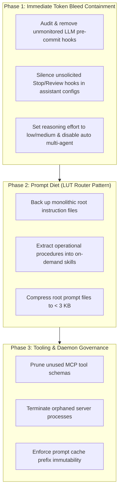

# Token Diet: Operational Remediation Playbook

A structured, step-by-step engineering guide to contain token leaks, prune static context overhead, and optimize reasoning consumption across AI coding workflows.

---

## Remediation Workflow Overview



---

## Phase 1: Critical Immediate Containment (Stop the Bleed)

The primary goal of Phase 1 is to eliminate invisible, background API calls that drain token quotas without explicit user prompts.

### 1.1 Neutralize Silent Git Pre-Commit Hooks
* **Problem:** Some local review tools install hooks in `.git/hooks/pre-commit` that send complete file diffs to cloud LLMs on every `git commit`. A developer making 15 daily commits inadvertently triggers 15 unmetered LLM reviews.
* **Diagnosis:**
  ```bash
  token-diet
  ```
  If `token-diet` detects an irregular hook, it flags `🚨 IRREGULAR HOOK DETECTED`.
* **Remediation:**
  - **Automated Fix:**
    ```bash
    token-diet --fix-hooks
    ```
    This automatically creates a backup (`.git/hooks/pre-commit.bak`), comments out unmonitored AI review lines, and preserves executable permissions.
  - **Manual Review:**
    Inspect `.git/hooks/pre-commit`:
    ```bash
    cat .git/hooks/pre-commit
    ```
    Replace automated LLM reviews in local commits with deterministic static linters (`ruff`, `eslint`, `biome`). Reserve semantic AI reviews for Pull Request gates in CI.

### 1.2 Silence Unsolicited Lifecycle Hooks in Assistant Settings
* **Problem:** Assistant settings (e.g., `~/.claude/settings.json`) often register hooks on `Stop` or `SessionStart` events that trigger secondary agent runs or validation routines.
* **Remediation:**
  Inspect client settings files and remove or comment out automated review commands attached to `Stop` or `UserPromptSubmit` events.

### 1.3 Rationalize Reasoning Effort & Multi-Agent Spawning
* **Problem:** Setting `model_reasoning_effort = "high"` on reasoning models generates thousands of hidden chain-of-thought tokens on trivial syntax or file inspection tasks. Unsupervised multi-agent settings (`max_threads > 1`) multiply this burn across parallel processes.
* **Remediation:**
  - Default reasoning effort to `low` or `medium` for routine coding.
  - Reserve `high` reasoning effort for complex algorithmic architecture tasks under explicit user command.
  - Disable automatic background multi-agent fan-out (`multi_agent = false` or `max_threads = 1`).

---

## Phase 2: Prompt Diet & The Look-Up Table (LUT) Router Pattern

The goal of Phase 2 is to reduce static baseline context from **~70,000+ base tokens per turn down to < 2,500 tokens**.

### 2.1 The Problem with Monolithic Prompts
Injecting entire procedure manuals, team arbitration rules, and memory frameworks into root instruction files (`CLAUDE.md`, `AGENTS.md`, `GEMINI.md`) forces the model to re-ingest the entire manual on every single turn. When prompt cache TTL expires (typically 5 minutes of inactivity), this entire block is billed as a full input cache miss.

### 2.2 The Look-Up Table (LUT) Pattern
Instead of placing full operational manuals inline, transform root directive files into a **Look-Up Table (LUT) Router**:
1. Keep only core behavioral invariants in the root file (< 50 lines / < 3 KB):
   - Language and code formatting preferences.
   - Commitment to test-driven development (TDD).
   - Prohibition of hallucinated citations and unverified statements.
2. Convert specialized protocols into **On-Demand Skills** located in dedicated directories (e.g., `skills/<skill-name>/SKILL.md`):
   - Refactoring protocols.
   - Review arbitration and dual-judgment procedures.
   - Database migration runbooks.
3. The root directive routes to skills on demand:
   ```markdown
   ## Available Skills (On-Demand)
   When performing complex refactoring, read `skills/refactor/SKILL.md`.
   When auditing security before release, read `skills/oss-publisher/SKILL.md`.
   ```

---

## Phase 3: Tooling, MCP Schemas & Daemon Governance

### 3.1 Prune Oversized MCP Server Schemas
* Every active MCP server serializes its entire JSON parameter schema into the system prompt on every request.
* Registering 4–5 servers with dozens of tools adds 15,000–25,000 tokens of fixed overhead.
* **Action:** Disable unused MCP servers in client configuration files. Enable lazy-loading tool discovery when supported by your client.

### 3.2 Terminate Orphaned Processes
* Background tool processes (e.g., language servers, code indexing watchdogs) can linger after sessions close, consuming system resources and holding network ports open.
* Regularly audit active development processes:
  ```bash
  ps aux | grep -iE 'mcp|codegraph|daemon'
  ```

### 3.3 Preserve Prompt Cache Prefix Immutability
* Providers (Anthropic, OpenAI, Google) offer discounts (up to 90%) when prompt prefixes are byte-for-byte identical across turns.
* **Action:** Never prepend dynamic timestamps, randomized UUIDs, or unstable session states to the top of prompt directive files. Keep the initial token sequence completely deterministic.

---

## Automated Verification

Verify your environment after applying remediation:

```bash
# 1. Audit local project directives and hooks:
token-diet

# 2. Audit system-wide global configurations:
token-diet --global

# Target budget: Total tokens < 3,000 per turn, 0 hook alerts.
```
