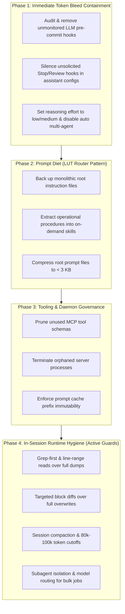
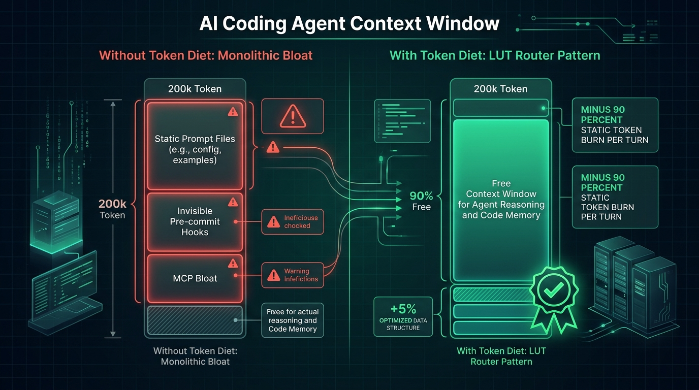

# Token Diet: Operational Remediation Playbook

A structured, step-by-step engineering guide to contain token leaks, prune static context overhead, and optimize reasoning consumption across AI coding workflows.

---

## Architectural Framework: Audit, Detect, Enforce, Recommend

The remediation playbook maps directly to Token Diet's four core capabilities:

| Capability | Role in Remediation | Primary Mechanism |
|---|---|---|
| **Audit** | Scan repository instructions, declared MCP schemas, and active git hooks. | `token-diet`, `token-diet --mcp`, `token-diet --sections` |
| **Detect** | Identify bloat warnings (`[ALERT]`, `[WARN]`) and silent AI pre-commit invocations. | Visual heuristics, hook regex scanning |
| **Enforce** | Prevent regressions in CI and pre-commit with deterministic gates. | `token-diet --strict`, `--max-tokens`, `--baseline`, `--max-delta` |
| **Recommend** | Apply architectural patterns to eliminate invisible waste. | Look-Up Table (LUT) Router, On-Demand Skills, In-Session Hygiene |

---

## Remediation Workflow Overview



---

## Phase 1: Critical Immediate Containment (Stop the Bleed)

The primary goal of Phase 1 is to eliminate invisible, background API calls that drain token quotas without explicit user prompts.

### 1.1 Neutralize Silent Git Pre-Commit Hooks
* **Problem:** Some local review tools install hooks in `.git/hooks/pre-commit` that send complete file diffs to cloud LLMs on every `git commit`. A developer making 15 daily commits inadvertently triggers 15 unmetered LLM reviews.
* **Diagnosis:**
  ```bash
  token-diet
  ```
  If `token-diet` detects an irregular hook, it flags `🚨 IRREGULAR HOOK DETECTED`.
* **Remediation:**
  - **Automated Fix:**
    ```bash
    token-diet --fix-hooks
    ```
    This automatically creates a backup (`.git/hooks/pre-commit.bak`), comments out unmonitored AI review lines, and preserves executable permissions.
  - **Manual Review:**
    Inspect `.git/hooks/pre-commit`:
    ```bash
    cat .git/hooks/pre-commit
    ```
    Replace automated LLM reviews in local commits with deterministic static linters (`ruff`, `eslint`, `biome`). Reserve semantic AI reviews for Pull Request gates in CI.

### 1.2 Silence Unsolicited Lifecycle Hooks in Assistant Settings
* **Problem:** Assistant settings (e.g., `~/.claude/settings.json`) often register hooks on `Stop` or `SessionStart` events that trigger secondary agent runs or validation routines.
* **Remediation:**
  Inspect client settings files and remove or comment out automated review commands attached to `Stop` or `UserPromptSubmit` events.

### 1.3 Rationalize Reasoning Effort & Multi-Agent Spawning
* **Problem:** Setting `model_reasoning_effort = "high"` on reasoning models generates thousands of hidden chain-of-thought tokens on trivial syntax or file inspection tasks. Unsupervised multi-agent settings (`max_threads > 1`) multiply this burn across parallel processes.
* **Remediation:**
  - Default reasoning effort to `low` or `medium` for routine coding.
  - Reserve `high` reasoning effort for complex algorithmic architecture tasks under explicit user command.
  - Disable automatic background multi-agent fan-out (`multi_agent = false` or `max_threads = 1`).

---

## Phase 2: Prompt Diet & The Look-Up Table (LUT) Router Pattern

The goal of Phase 2 is to reduce static baseline context from **~8,400 base tokens per turn down to < 750 tokens**, preserving over 92% of working context memory for code and reasoning.

### 2.1 The Technical Reality of Prompt Caching & The Cost of Bloat

> [!IMPORTANT]
> **Prompt Caching & Context Headroom Reality**  
> *Smaller static context reduces context-window pressure and cache-miss exposure. However, prompt caching depends on prefix stability, provider-specific caching rules and request structure, not prompt size alone.*

A common misconception among developers using modern LLM APIs is:
> *"Since Anthropic and OpenAI support prompt caching at up to 90% discount, large instruction files don't matter."*

This is technically inaccurate for two critical reasons:

#### 1. How Prefix Caching Actually Operates
Prefix cache eligibility is determined strictly by prefix immutability and meeting minimum length thresholds (e.g., 1,024 tokens for Anthropic Claude Sonnet/Opus and OpenAI), not by keeping files below an arbitrary small size ceiling. Prefix caching matches tokens sequentially from **token index 0**:
* **Anthropic:** Caches sequential prefix blocks of at least 1,024 tokens (2,048 tokens on Haiku).
* **OpenAI:** Automatically matches cached prefixes in 1,024-token increments starting at the top of the request.

A static, long prompt **does NOT fail cache eligibility by itself**. As long as the prompt is byte-for-byte identical at the beginning of the message payload, cache hits will occur regardless of file size. What **breaks** prefix caching is:
* Prepending dynamic timestamps, dates, or volatile session UUIDs before the static block.
* Introducing unpinned environment variables or dynamic workspace paths.
* Modifying even a single character in the preamble.
* Re-ordering declared MCP tool definitions ahead of instructions.

#### 2. The True Operational Cost of Bloat
Even when cache hits occur, monolithic prompts create severe operational bottlenecks:
* **The Cache Miss / TTL Expiry Penalty:** Cache entries are ephemeral. In Anthropic, prompt cache TTL is typically **5 minutes of developer pause**; in OpenAI, cache chunks are evicted under memory pressure. When TTL expires or a cache miss occurs, the developer pays **100% of the standard input rate** across 25+ KB (~6,000–8,400 tokens) of instructions on every single turn.
* **Context Window Starvation:** Cache hit or miss, **cached tokens consume active context window capacity**. 8,400 tokens of static rules permanently rob the model of active attention on every turn.
* **Reasoning Dilution ("Needle-in-a-Haystack" Failure):** Drowning the model in 25 KB of monolithic guidelines dilutes attention. Frontier models suffer retrieval and instruction-following degradation when key constraints are buried in pages of irrelevant protocols.

### 2.2 Simulated 20-Turn Session Model: Monolithic Directives vs. Token Diet LUT Router

Below is a simulated 20-turn session model comparing base context consumption and memory retention between a monolithic directive and a decoupled Look-Up Table (LUT) Router:



| Metric | Monolithic Directives (No Diet) | With Token Diet (LUT Router) | Impact / Gain |
|---|:---:|:---:|:---:|
| **Base Overhead per Turn** | ~8,400 tokens | ~750 tokens | **-91% base tokens** |
| **Cumulative Ingestion (20 Turns)** | ~168,000 tokens | ~15,000 tokens | **-153,000 tokens spared** |
| **Boilerplate Context Share** | **~75%** of base context | **< 8%** of base context | **-67% static context footprint** |
| **Active Context Headroom for Code & Reasoning** | **~25%** (Heavily constrained) | **> 92%** (Abundant capacity) | **+70% freed working headroom** |
| **Cache Miss Re-ingestion Penalty** | 8,400 tokens / miss | 750 tokens / miss | **-91% penalty exposure** |
| **Attention Focus & Retrieval Accuracy** | High risk of instruction dilution | Laser-focused on active task | **Minimizes attention dilution & Lost-in-the-Middle retrieval degradation** |

> [!NOTE] **Methodological Framework & Model Parameters**
> - **Token Estimation Heuristic:** Based on the standard `cl100k_base` heuristic (~4 characters/bytes per token for structured Markdown/prose).
> - **Session Dynamics:** Models a standard 20-turn active coding workflow where the monolithic directive (~8,400 tokens) is re-ingested into context on every turn versus the LUT Router (base ~750 tokens + ~1,200 tokens during turns where specialized domain skills are loaded on demand).
> - **Reference Context Window:** Calibrated against standard active context windows (e.g., 128k/200k tokens), demonstrating how the LUT Router frees working memory for code context and compiler diagnostics rather than static boilerplate.

*In a monolithic setup, ~75% of your conversational memory is permanently consumed by idle instructions that are never executed in the session. Token Diet's LUT Router preserves > 92% of working memory for actual code, AST analysis, and compiler feedback.*

### 2.3 The Look-Up Table (LUT) Router Pattern
Instead of placing full operational manuals inline, transform root directive files into a **Look-Up Table (LUT) Router**:
1. Keep only core behavioral invariants in the root file (< 50 lines / < 3 KB / < 750 tokens):
   - Language and code formatting preferences.
   - Commitment to test-driven development (TDD).
   - Prohibition of hallucinated citations and unverified statements.
2. Convert specialized protocols into **On-Demand Skills** located in dedicated directories (e.g., `skills/<skill-name>/SKILL.md`):
   - Refactoring protocols.
   - Review arbitration and dual-judgment procedures.
   - Database migration runbooks.
3. The root directive routes to skills on demand:
   ```markdown
   ## Available Skills (On-Demand)
   When performing complex refactoring, read `skills/refactor/SKILL.md`.
   When auditing security before release, read `skills/oss-publisher/SKILL.md`.
   ```

---

## Phase 3: Tooling, MCP Schemas & Daemon Governance

### 3.1 Prune Oversized MCP Server Schemas
* Every active MCP server serializes its entire JSON parameter schema into the system prompt on every request.
* Registering 4–5 servers with dozens of tools adds 15,000–25,000 tokens of fixed overhead.
* **Action:** Disable unused MCP servers in client configuration files. Enable lazy-loading tool discovery when supported by your client.

### 3.2 Terminate Orphaned Processes
* Background tool processes (e.g., language servers, code indexing watchdogs) can linger after sessions close, consuming system resources and holding network ports open.
* Regularly audit active development processes:
  ```bash
  ps aux | grep -iE 'mcp|codegraph|daemon'
  ```

### 3.3 Preserve Prompt Cache Prefix Immutability
* Frontier providers (Anthropic, OpenAI, Google) match prefix tokens sequentially from token 0.
* **Action:**
  - Never prepend dynamic timestamps, current clock times, randomized UUIDs, or unstable session states to the top of prompt directive files.
  - Maintain absolute byte-level determinism in system prompt preambles and root files.
  - Keep tool schema ordering identical between invocations to ensure prefix cache checkpoints hit consistently.

---

## Phase 4: In-Session Runtime Hygiene (Active Execution Guards)

While Phases 1–3 secure static repository directives and developer infrastructure, Phase 4 governs the **live conversation loop**. Unmonitored agents frequently burn hundreds of thousands of tokens within a single debugging session through careless file dumping, full-file rewrites, and monolithic conversation threads.

### 4.1 Grep-First & Line-Range Inspections (No Blind Dumps)
* **Problem:** An agent inspecting a single error loads an entire 1,500-line file (~4,000–6,000 tokens). That file payload remains in the conversation history and is re-billed on **every subsequent turn**. Five turns later, that single full-file read has cost 25,000 input tokens.
* **Bad Pattern:** Calling `view_file` or `cat` without line limits on large source files.
* **Remediation Pattern:**
  1. Use deterministic symbol searches (`grep -n`, `ripgrep`, or code search tools) to pinpoint the exact line location.
  2. Inspect only the relevant context window using targeted line ranges (e.g., 30–80 lines centered around the target function or line).

| Reading Method | Typical Turn Cost | Cost Across 5 Turns |
|---|:---:|:---:|
| Full file dump (1,500 lines) | ~5,000 tokens | **25,000 tokens** |
| Targeted range (50 lines) | ~180 tokens | **900 tokens** (96% savings) |

### 4.2 Targeted Block Diffs over Whole-File Rewrites
* **Problem:** Rewriting an entire 800-line file just to adjust 5 lines burns thousands of high-cost **output tokens** (billed at 3x–5x input pricing) and invalidates intermediate prompt cache prefixes.
* **Remediation Pattern:**
  - Always enforce patch- or replacement-based edit tools (such as `replace_file_content` or `git apply`).
  - Restrict diffs to the minimal contiguous block containing the modification.
  - Never regenerate an entire module when modifying individual functions or variables.

### 4.3 Context Compaction & 80k–100k Token Hard Cutoffs
* **Problem:** Long-running debugging sessions accumulate dead terminal output, stale file diffs, and obsolete stack traces. Once a thread exceeds ~80,000 tokens, response latency increases, attention recall degrades ("needle in a haystack" retrieval decay), and every prompt costs a fortune.
* **Remediation Pattern:**
  - Establish a hard ceiling: **Compact context or start a new thread at ~80,000–100,000 tokens**.
  - **Thread Handover Protocol:** When hitting the threshold:
    1. Have the agent produce a concise bulleted handover state (Goal, Current Progress, Remaining Blockers, Changed Files).
    2. Reset or branch the conversation thread, feeding only the handover summary as the starting state.

### 4.4 Subagent Isolation & Model Routing for Bulk Operations
* **Problem:** Running broad codebase sweeps, test suite log parsing, or multi-repo queries directly in your primary reasoning model floods the primary context with ephemeral data.
* **Remediation Pattern:**
  - **Isolate High-Volume Work:** Spawn lightweight, read-only subagents (or delegate tasks) with fast, economical models (e.g., `flash`, `haiku`) for bulk information retrieval.
  - The subagent digests the raw 50,000 tokens of logs or search hits and returns only a crisp, 200-token synthesized summary to the primary agent.
  - Match model tier to the task: Use frontier reasoning models (`pro`, `opus`) strictly for architectural decisions; route diagnostics, linting, and boilerplate generation to smaller tiers.

### 4.5 Terse Output Templates & Zero Fluff
* **Problem:** Conversational filler ("Sure thing! Let me help you with that...", "As you can see from the above code..."), repeating unmodified files, and verbose apologies burn premium output tokens.
* **Remediation Pattern:**
  - Configure agents to output concise, technical summaries: action taken, diff reference, test verification command.
  - Omit pleasantries, conversational transitions, and unrequested re-explanations of code.

### 4.6 Copy-Paste In-Session Guard Directives for AI Agents
To enforce these runtime guards automatically, add this block to your root agent directive file (`AGENTS.md` or `CLAUDE.md`):

```markdown
## In-Session Runtime Token Hygiene
- **Line-Range Reads:** Never read entire files >100 lines without specific user request. Use grep/symbols first, then read bounded line ranges (`start_line`, `end_line`).
- **Targeted Edits:** Always use patch/block replacements for existing files. Never overwrite whole files to apply localized changes.
- **Subagent Offloading:** Offload large grep sweeps or log processing to lightweight subagents; return only synthesized conclusions to this thread.
- **Output Conciseness:** Omit conversational filler and pleasantries. State action, diff summary, and verification command directly.
- **Context Ceiling:** If the session context approaches 80k tokens, prompt for a session compaction handover.
```

---

## Automated Verification

Verify your environment after applying remediation:

```bash
# 1. Audit local project directives and hooks:
token-diet

# 2. Audit system-wide global configurations:
token-diet --global

# Target budget: Total tokens < 3,000 per turn, 0 hook alerts.
```
